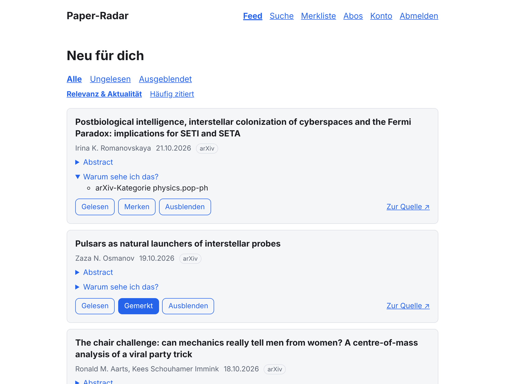

# Paper-Radar

Abonniere Themen, arXiv-Kategorien und Autor:innen und bekomme täglich einen
nachvollziehbar gerankten Feed neuer wissenschaftlicher Paper – **ohne Tracking,
ohne Algorithmus-Blase**, mit eigenem RSS-Feed und Wochen-Mail.



## Features

- **Abos** auf Stichwörter (Postgres-Websuche-Syntax: `"phrase"`, `or`, `-ausschließen`),
  arXiv-Kategorien (Auswahlliste aus der offiziellen Taxonomie) und Autor:innen (Name oder ORCID).
  Neue Abos laden die Paper der letzten 30 Tage nach.
- **Täglicher Feed** mit offengelegtem Ranking (Textrelevanz × Gewicht + Boosts ×
  Aktualität). Jedes Paper erscheint nur einmal, mit **„Warum sehe ich das?“**.
- **Aktionen** gelesen, merken und ausblenden. Dazu gibt es Filter, eine Sortierung
  „Häufig zitiert“, die Suche über die eigene Datenbank und eine Merkliste.
- **Detailseite** mit Links zu arXiv, DOI, Europe PMC, PubMed und OpenAlex. PDFs werden nur
  verlinkt, nie gespeichert.
- **BibTeX-Export** für einzelne Paper und die Merkliste.
- **Persönlicher RSS/Atom-Feed** unter geheimer, rotierbarer URL, zusätzlich ein Feed je Abo
  und **OPML-Export**.
- **Wochen-Mail** (Opt-in, Montag 7 Uhr) mit den Top-10 der Woche und Abmeldelink, inklusive
  Ein-Klick-Abmeldung.
- **Quellen**:
  - [arXiv](https://arxiv.org) (RSS und API)
  - [Europe PMC](https://europepmc.org) (Lebenswissenschaften inkl. Preprints)
  - [Crossref](https://www.crossref.org) (Metadaten-Ergänzung)
  - [OpenAlex](https://openalex.org) (Zitationszahlen)

  Alle Abfragen laufen zentral, dedupliziert und streng rate-limitiert.

- **Datenschutz:** Login per Magic-Link, gespeichert wird nur die E-Mail-Adresse. Es gibt
  kein Tracking und keine Drittressourcen, und das Konto ist jederzeit vollständig löschbar.
- Mobile-first, Hell/Dunkel-Modus, auch ohne JavaScript bedienbar. Freie Software (AGPL-3.0).

## Schnellstart mit Docker

Voraussetzungen: Docker mit Compose v2, eine Domain, die auf den Server zeigt (Ports 80/443
offen), und ein SMTP-Zugang für die Anmelde-Mails.

```bash
git clone https://github.com/HenryBehindlooker/Paper-Radar.git
cd Paper-Radar
cp .env.example .env
```

In `.env` mindestens anpassen:

```dotenv
DOMAIN=radar.example.org
ORIGIN=                                # leer lassen → https://<DOMAIN>
POSTGRES_PASSWORD=<langes zufälliges Passwort>
AUTH_SECRET=<Ausgabe von: openssl rand -base64 32>
SMTP_HOST=smtp.example.org
SMTP_PORT=465
SMTP_SECURE=true
SMTP_USER=…
SMTP_PASSWORD=…
MAIL_FROM="Paper-Radar <radar@example.org>"
CONTACT_EMAIL=admin@example.org        # empfohlen: Kontakt für die Datenquellen
OPENALEX_API_KEY=…                     # optional, für Zitationszahlen
```

```bash
docker compose up -d --build
```

Caddy holt automatisch ein Let's-Encrypt-Zertifikat. Danach ist die Instanz unter
`https://<DOMAIN>` erreichbar.

| Dienst     | Aufgabe                                                                  |
| ---------- | ------------------------------------------------------------------------ |
| `postgres` | Daten und Job-Queue (Volume `pgdata`)                                    |
| `migrate`  | wendet beim Start einmalig die Datenbank-Migrationen an                  |
| `app`      | Web-App (SvelteKit, Port 3000 nur intern)                                |
| `worker`   | Hintergrund-Jobs, einziger Prozess mit Zugriff auf die Datenquellen      |
| `caddy`    | HTTPS-Reverse-Proxy (Ports 80/443), ohne Zugriffs-Logs                   |
| `backup`   | nächtlicher `pg_dump` ins Volume `backups`                               |
| `mailpit`  | nur mit `--profile mailpit`: fängt alle Mails ab (http://localhost:8025) |

> **Genau ein Worker:** Die Rate-Limiter für die Datenquellen gelten pro Prozess. Skaliere den
> `worker`-Dienst nicht hoch.

**Lokal ausprobieren**, ohne eigene Domain und ohne echten Mailserver. In `.env` setzen:

```dotenv
DOMAIN=localhost
ORIGIN=
SMTP_HOST=mailpit
SMTP_PORT=1025
POSTGRES_PASSWORD=<beliebig>
AUTH_SECRET=<Ausgabe von: openssl rand -base64 32>
```

```bash
docker compose --profile mailpit up -d --build
```

Danach `https://localhost` öffnen. Caddy nutzt hier ein selbstsigniertes Zertifikat, das der
Browser einmal bestätigen will. Die Anmelde-Mail erscheint unter http://localhost:8025.

## Schnellstart für die Entwicklung

Voraussetzungen: Node.js ≥ 22.12, Docker (für PostgreSQL 16 und Mailpit).

```bash
cp .env.example .env                             # AUTH_SECRET setzen: openssl rand -base64 32
docker compose -f docker-compose.dev.yml up -d   # PostgreSQL (+ Test-DBs) und Mailpit
npm install
npm run db:migrate                               # Schema anlegen
npm run worker                                   # Hintergrund-Jobs (separates Terminal)
npm run dev                                      # Web-App: http://localhost:5173
```

Den Magic-Link findest du in Mailpit unter http://localhost:8025.

| Befehl                   | Zweck                                                           |
| ------------------------ | --------------------------------------------------------------- |
| `npm run dev`            | Dev-Server                                                      |
| `npm run worker`         | Worker (pg-boss-Jobs)                                           |
| `npm run db:generate`    | Migration aus `src/lib/server/db/schema.ts` erzeugen            |
| `npm run db:migrate`     | Migrationen anwenden (macht der Worker beim Start ebenfalls)    |
| `npm run job -- <queue>` | Job sofort einreihen, z. B. `ingest-arxiv-daily`, `backfill 42` |
| `npm run build`          | Produktions-Build (App nach `build/`, Worker nach `dist/`)      |
| `npm run lint`           | Prettier-Check, ESLint, svelte-check (TypeScript strict)        |
| `npm test`               | Unit- und Integrationstests (Vitest)                            |
| `npm run test:e2e`       | E2E-Tests (Playwright; braucht PostgreSQL und Mailpit)          |
| `npm run test:live`      | optional: Adapter einmal gegen die echten APIs                  |

Die Integrationstests brauchen `TEST_DATABASE_URL`. Diese Datenbank wird bei jedem Lauf
**geleert**, ohne die Variable werden die Tests übersprungen. Die E2E-Tests laufen gegen
`paperradar_e2e` und lesen Magic-Links über die Mailpit-API.

Aufbau, Datenmodell, Ranking und Jobs sind in [docs/ARCHITECTURE.md](docs/ARCHITECTURE.md)
beschrieben.

## Konfiguration

Alle Einstellungen laufen über Umgebungsvariablen in `.env` (Vorlage:
[`.env.example`](.env.example)). Secrets gehören nur in `.env` und nie ins Repository.

| Variable                                                             | Zweck                                                                                  |
| -------------------------------------------------------------------- | -------------------------------------------------------------------------------------- |
| `DOMAIN`                                                             | Domain für Caddy/HTTPS (Docker)                                                        |
| `ORIGIN`                                                             | öffentliche Basis-URL; mit Docker leer lassen (→ `https://<DOMAIN>`)                   |
| `POSTGRES_USER` / `_PASSWORD` / `_DB`                                | Datenbank-Zugang (Docker baut daraus `DATABASE_URL`)                                   |
| `DATABASE_URL`                                                       | Verbindungs-URL (nur ohne Docker nötig)                                                |
| `AUTH_SECRET`                                                        | Pflicht. Signiert Sessions, Feed-URLs und Abmeldelinks; ändern macht diese ungültig    |
| `SMTP_HOST` / `_PORT` / `_SECURE` / `_USER` / `_PASSWORD`            | Mailversand (Magic-Links, Wochen-Mail)                                                 |
| `MAIL_FROM`                                                          | Absender der Mails                                                                     |
| `CONTACT_EMAIL`                                                      | Kontakt im User-Agent und für den Crossref-„Polite Pool“ (empfohlen)                   |
| `OPENALEX_API_KEY`                                                   | aktiviert die OpenAlex-Anreicherung (kostenlos, nur serverseitig genutzt)              |
| `OPENALEX_DAILY_CREDIT_BUDGET` / `_REQUEST_LIMIT` / `_MIN_RELEVANCE` | Tagesbudget und Auswahl für OpenAlex                                                   |
| `RANKING_HALF_LIFE_DAYS`                                             | Halbwertszeit des Aktualitäts-Abfalls (Standard 7)                                     |
| `HTTP_PORT` / `HTTPS_PORT`                                           | Host-Ports von Caddy (Standard 80/443)                                                 |
| `BACKUP_SCHEDULE` / `BACKUP_KEEP_DAYS`                               | Backup-Zeitplan (Cron, UTC; Standard `30 2 * * *`) und Aufbewahrung (Standard 14 Tage) |
| `LOG_LEVEL`                                                          | `debug`, `info`, `warn` oder `error`                                                   |

## Betrieb

### Gesundheitsstatus

`GET /api/health` liefert JSON mit Datenbank, Queue (Warteschlangen, Herzschlag des Workers) und
dem letzten Abruf je Datenquelle:

- **HTTP 503**, wenn Datenbank oder Queue nicht erreichbar sind. Der Docker-Healthcheck der App
  nutzt das.
- **HTTP 200 mit `status: "degraded"`**, wenn der Worker fehlt oder der letzte Abruf einer
  Quelle fehlschlug. Der Ausfall einer Quelle stoppt die anderen nicht und ist hier sichtbar.

### Backups

Der Dienst `backup` erstellt jede Nacht um 02:30 UTC einen `pg_dump` im Custom-Format im Volume
`backups` und löscht Dumps, die älter als 14 Tage sind.

```bash
# Backup sofort anlegen
docker compose exec backup paper-radar-backup

# Vorhandene Backups anzeigen
docker compose exec backup ls -lh /backups

# Backup auf den Host kopieren (für die Ablage außerhalb des Servers)
docker compose cp backup:/backups/paperradar-YYYYMMDD-HHMMSS.dump ./

# Wiederherstellen – ersetzt die komplette Datenbank durch den Stand des Backups!
docker compose stop app worker
docker compose exec backup paper-radar-restore /backups/paperradar-YYYYMMDD-HHMMSS.dump
docker compose start app worker
```

Die Backups liegen auf demselben Server. Kopiere sie zusätzlich regelmäßig an einen anderen
Ort.

### Aktualisieren

```bash
git pull
docker compose up -d --build
```

Datenbank-Migrationen laufen dabei automatisch (Dienst `migrate`).

## Datenquellen & Lizenzen

Paper-Radar speichert nur Metadaten und Links, keine PDFs. Endpunkte, Rate-Limits, Lizenzen
und Attributionspflichten jeder Quelle sind in [docs/DATA_SOURCES.md](docs/DATA_SOURCES.md)
dokumentiert und live geprüft.

- **arXiv:** Metadaten unter CC0. Pflicht-Hinweis in der Fußzeile: „Thank you to arXiv for use
  of its open access interoperability.“ Höchstens 1 Request alle 3 Sekunden.
- **Europe PMC:** Es gelten die Rechte der Verlage bzw. Autor:innen. Abstracts werden nur bei
  offener Lizenz angezeigt.
- **Crossref:** Metadaten sind frei, Abstracts werden nur bei Creative-Commons-Lizenz
  übernommen. Mit `CONTACT_EMAIL` läuft der Zugriff über den „Polite Pool“.
- **OpenAlex:** CC0, ausschließlich Einzelabrufe mit Tagesbudget.

## Datenschutz

- Gespeichert wird nur die **E-Mail-Adresse**, dazu Abos, Treffer, Merkliste und Markierungen.
- Es gibt **kein Tracking**, keine Analyse-Dienste und keine eingebundenen Ressourcen von
  Drittanbietern. Caddy schreibt keine Zugriffs-Logs.
- Cookies: nur das Sitzungs-Cookie nach der Anmeldung (`httpOnly`, `secure`, `sameSite=lax`).
- Mails enthalten keine Tracking-Pixel. Die Wochen-Mail ist Opt-in und hat einen Abmeldelink.
- **Konto löschen** unter „Konto“ entfernt sofort alle personenbezogenen Daten.

## Mitmachen

Beiträge sind willkommen – siehe [CONTRIBUTING.md](CONTRIBUTING.md). Änderungen stehen im
[CHANGELOG](CHANGELOG.md).

## Lizenz

[GNU Affero General Public License v3.0](LICENSE). Wer eine geänderte Version als Dienst
betreibt, muss den Quellcode der Änderungen den Nutzer:innen zugänglich machen.
